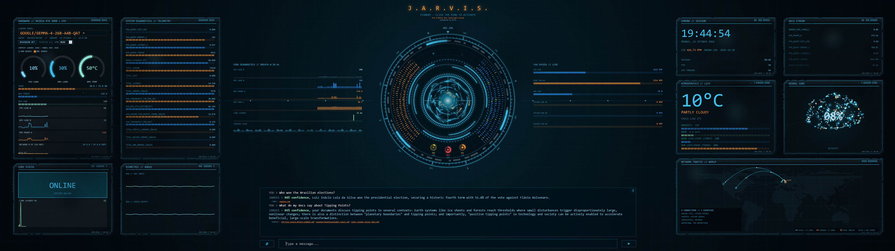
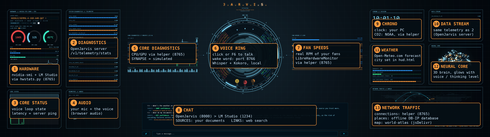

# IronMan J.A.R.V.I.S. – An IronMan-Style Web-Interface with all the Bells & Whistles

*Tony Stark had a billion dollars and a genius brain. I had a free Claude web chat and 36 hours.*


<sub>The HUD at 5120x1440. Click the image to see it full size.</sub>


<sub>Every orange box says where that panel gets its data. The full list is further down.</sub>

> **Credit where it is due:** this is a **fork of [OpenJarvis](https://github.com/open-jarvis/OpenJarvis)** (Apache-2.0). The brain, the server and the engine are theirs. I added the full-screen HUD, voice, smart-home tools and installer on top. Please go give the original project a star. The original README is in [docs/OPENJARVIS-README.md](docs/OPENJARVIS-README.md).

## The honest part

- I am **not a developer**. This is my **first GitHub project**.
- It took **36 hours**, built entirely in the **free Claude web chat** (so: lots of patience, very small steps).
- In other words: I **vibecoded** this whole project with the free version of Claude. No paid plan, no coding background.
- It runs great on my PC. On yours? I am as curious as you are. The installer has **not** been tested on a freshly wiped PC.
- Be nice. Open an issue if something breaks and tell me what you saw.

## What you get

- **Full-screen HUD** with live GPU/CPU gauges, telemetry, weather, CO2, a world map of your network connections and a glowing 3D brain.
- **Cinematic look:** a startup animation (click to skip) and worn, scratched sci-fi panels with soft colors, inspired by the interface of a certain modern war game. The wear pattern is random on every page load.
- **Talk to it.** Say "Hey Jarvis" (optional wake word, [openWakeWord](https://github.com/dscripka/openWakeWord)) or press **F6**. Say "Thanks!" or press **Esc** to stop listening. It listens (Whisper), thinks (your local model in LM Studio) and answers out loud (Kokoro). Press **Esc** while it talks and it shuts up. (Saying "stop" works too, but not reliably: speaker echo confuses the microphone. A headset helps.)
- **Everything local.** The AI runs on your PC through [LM Studio](https://lmstudio.ai). No cloud AI, no account.
- **Model control inside the HUD:** switch the LM Studio model, set the context size, toggle reasoning.
- **[Philips Hue](https://www.philips-hue.com/en-us/explore-hue) lights (optional):** "turn off the kitchen lights". Every change is read back from the bridge, so Jarvis cannot just claim it worked.
- **[Tado](https://www.tado.com/en) heating (optional):** "heating off in the living room".
- **Two desktop icons:** **Jarvis** starts everything, **Stop Jarvis** shuts everything down again (servers, LM Studio, the helper tabs). The helper programs run hidden in one terminal tab ("Jarvis Services", logs in `%USERPROFILE%\.openjarvis\logs`).
- **Live fan speeds:** the HUD shows the real RPM of your CPU fan, water pump and case fans next to the GPU fan. The installer sets up the free [LibreHardwareMonitor](https://github.com/LibreHardwareMonitor/LibreHardwareMonitor) for this (Windows asks for administrator permission once), see [Live fan speeds](#live-fan-speeds-the-installer-sets-this-up).
- **News headlines:** "BBC news" or "Hacker News headlines" with clickable links.
- **Web search (optional):** uses the [Firecrawl Web Data API](https://www.firecrawl.dev/) and needs your own free API key. It also reads a web page or PDF when you give it a link.
- **Document search (experimental, fussy):** ask questions about your own files and get sources with links. Needs the LM Studio plugin [*Big RAG*](https://lmstudio.ai/mindstudio/big-rag) and some patience.
- **Privacy first:** upstream analytics (PostHog) are **switched off**. All Jarvis ports listen on `127.0.0.1` only. Keys never go into files in this repo.
- **English only on purpose.** The voice does not pronounce other languages correctly, so speech is set to English.

## What you need

| | |
|---|---|
| OS | **Windows 11** and **Windows PowerShell 5** (the blue one that comes with Windows, not PowerShell 7) |
| GPU | NVIDIA recommended (gauges need `nvidia-smi`). Built on an RTX 5090. Without a GPU the HUD still runs, the GPU gauges just show zeros. |
| RAM | 64 GB on my PC. 16 GB works with a small model. |
| Screen | Designed for 5120x1440 ultrawide. Smaller screens get a compact layout (tested at 1366x768). |
| Browser | Firefox (what I use). Allow the microphone. |
| Programs | Git, uv, Node.js, Rust, Windows Terminal, LM Studio. The installer offers to install any that are missing. |

## Disk space: plan for about 25 GB free

- **3.2 GB** the project folder after install (measured on my PC)
- **about 16 GB** the default model `google/gemma-4-26b-a4b-qat` (small PC? take `google/gemma-4-e2b`, about 4.4 GB)
- **a few hundred MB** voice model and wake word files

## Install

1. Install Git if you do not have it: `winget install --id Git.Git -e`
2. Open a **normal** (not admin) PowerShell and run:

```powershell
git clone -b ironman https://github.com/ChrisMan4000/IronMan-JARVIS.git
cd IronMan-JARVIS
powershell -ExecutionPolicy Bypass -File .\install-jarvis.ps1
```

3. The installer asks before every optional part ([Philips Hue](https://www.philips-hue.com/en-us/explore-hue), [Tado](https://www.tado.com/en), the wake word, the language model, document search, and the [Firecrawl Web Data](https://www.firecrawl.dev/) API key) and shows a link for each one. If it installs programs, it tells you to open a new PowerShell and run it again. Finished parts are skipped.
4. Open LM Studio once and run `lms bootstrap`. The installer then asks which model to use: pick one you already have in LM Studio, or let it download a ~2 GB, ~8 GB or ~15 GB model (it recommends one for your graphics card). Run `install-jarvis.ps1` again to change it.
   The installer also offers **document search** (Step 6c, optional): it downloads the embedding model and installs the LM Studio plugin *Big RAG* (see [Optional: document search](#optional-document-search)).
5. Double-click the **Jarvis** icon on your desktop. Allow the microphone in the browser.

**No Git? Use the installer instead:** download `IronMan-JARVIS-Installer.exe` from the [Releases page](https://github.com/ChrisMan4000/IronMan-JARVIS/releases) and run it. It unpacks the project to `%LOCALAPPDATA%\IronMan-JARVIS` and asks the optional questions in the installer window itself, in HUD colors, each with a "learn more" link: [Philips Hue](https://www.philips-hue.com/en-us/explore-hue) (bridge IP), [Tado](https://www.tado.com/en), the wake word ([openWakeWord](https://github.com/dscripka/openWakeWord)), the language model ([LM Studio](https://lmstudio.ai); it shows the models you already have and recommends a size for your PC), document search ([Big RAG](https://lmstudio.ai/mindstudio/big-rag)) and the [Firecrawl Web Data](https://www.firecrawl.dev/) API key. It then runs `install-jarvis.ps1` hidden with your answers and shows the progress (10 steps, text per step; model downloads show no percentage). Details are written to `%USERPROFILE%\.openjarvis\install-log.txt`. You can still run `install-jarvis.ps1` yourself in PowerShell, it then asks the same questions there (steps 3-5 above apply). The window installer is new and untested. It is a pre-release, not code-signed (Windows SmartScreen will warn: "More info" > "Run anyway") and not yet tested on a freshly wiped PC. LM Studio, uv, Python and the models are downloaded during setup, not packed inside. To uninstall, run `uninstall-jarvis.ps1` first (see "Uninstall"), then remove the app in Windows Settings.

Set your city in `frontend/public/hud.html` (search for `HOME_CFG`). Four values: name, latitude, longitude, time zone. The default is London.

## Live fan speeds (the installer sets this up)

The installer downloads and sets up the free LibreHardwareMonitor for you (Windows asks for administrator permission once). If you install by hand, or it failed, do this:

The HUD can show real fan speeds (CPU fan, water pump, case fans) next to the GPU fan. Windows has no simple built-in way to read them, so this uses the free [LibreHardwareMonitor](https://github.com/LibreHardwareMonitor/LibreHardwareMonitor/releases). Which fans show up depends on your mainboard. Without it, the panel just says `LIBREHARDWAREMONITOR OFFLINE` and everything else works.

1. Download LibreHardwareMonitor and unzip it into `C:\Program Files\LibreHardwareMonitor`.
2. Start it once by hand (as administrator). In its **Options** menu turn on **Remote Web Server > Run** (port 8085) and make sure **Run On Windows Startup** is **off**. Then close it.
3. Open a PowerShell **as administrator** in this folder and run: `powershell -ExecutionPolicy Bypass -File .\tools\setup-fan-monitor.ps1`

From then on, starting Jarvis starts LibreHardwareMonitor hidden, and it closes itself about 30 seconds after Jarvis has stopped. Its tray icon can be hidden in Windows Settings > Personalization > Taskbar > Other system tray icons.

**Why the firewall rule?** LibreHardwareMonitor's web server listens on every network interface, without a password (and it writes that setting back on every start). The setup script therefore adds a firewall rule that blocks port 8085 from the network; this PC can still read it. The setup script has not been tested on a freshly wiped PC. The uninstaller removes the task and the rule (run it as administrator for that part).

## Optional: document search

Ask Jarvis about your own PDF, Word, Excel and text files and get sources with links. It uses the LM Studio plugin *Big RAG* (`mindstudio/big-rag`) to build the index and the `oracle_search` tool to read it. Indexing thousands of files takes hours; it is fussy, so treat it as experimental.

1. Answer **y** to Step 6c of `install-jarvis.ps1`. It downloads the embedding model `nomic-ai/nomic-embed-text-v1.5-GGUF`, installs the plugin (command line first, then the `lmstudio://` link; click install in LM Studio if asked) and creates the documents folder (`JARVIS_DOC_ROOT`, default `Documents\ORACLE`).
2. Put your documents in that folder.
3. In LM Studio open a chat, enable the Big RAG plugin and set: documents folder, an index folder (for example `C:\AI\Big-RAG`), embedding model `nomic-ai/nomic-embed-text-v1.5-GGUF`. Send one message; the first run indexes everything (slow). New files are only added when this runs again.
4. In the Jarvis folder run `uv run --no-sync python tools\ragcache.py` (converts the index for Jarvis; rerun it after every re-index).

The plugin only works inside LM Studio's own chat; Jarvis reads its index files directly. Not tested on a freshly wiped PC. Without the plugin everything else works.

## Memory: Jarvis remembers things

Tell Jarvis "my car is a blue Beetle" and it still knows in the next chat. This is OpenJarvis's own memory service, switched on by `[memory] enabled = true` in `config.toml` (it is on in `config.example.toml`; set it to `false` to turn it off, then restart the server). After each exchange the loaded model picks out durable facts (one extra model call per exchange) and stores them **only on your PC** in `~/.openjarvis/memory_facts.jsonl` (at most 1000, the oldest are dropped). Small models sometimes store wrong facts. When you correct yourself ("I sold the Mini, I now drive a green Golf"), the old fact is replaced: one more model call checks which stored facts the new one contradicts and deletes them (best effort; a small model may occasionally delete a merely related fact).

- See what it remembers: `uv run --no-sync jarvis memory list`
- Forget everything: `uv run --no-sync jarvis memory clear`
- Do not tell Jarvis passwords or keys: they could end up in that file.
- HUD chat history: the chat log and the conversation survive Ctrl+F5 (kept in your browser, last 40 messages). The trash-can button in the top-right corner of the chat box deletes it (click twice); `hud.html?fresh` clears it too.

## Uninstall ("Project Jarvis" gone)

```powershell
cd IronMan-JARVIS
powershell -ExecutionPolicy Bypass -File .\uninstall-jarvis.ps1
```

It shows what it will remove and its size, and you must type `UNINSTALL` to continue. It removes the project folder, your Jarvis settings, keys and logs in `%USERPROFILE%\.openjarvis`, the desktop icons (Jarvis and Stop Jarvis) and the Jarvis environment settings. It **never** touches Git, Node, uv, Rust, LM Studio or your downloaded models. If you also use plain OpenJarvis, note that it shares the `.openjarvis` settings folder.

## Where does the HUD get its data?

See the annotated screenshot at the top. Here is the same information as text:

| # | Panel | Source |
|---|---|---|
| 1 | Hardware | `tools/hwstats.py` (port 8765): `nvidia-smi`, Windows counters, LM Studio |
| 2 | Diagnostics | OpenJarvis server: `/v1/telemetry/stats` and `/energy` |
| 3 | Core status | state of the voice loop in `hud.html`; latency = ping of the Jarvis server |
| 4 | Audio | level of your microphone and of Jarvis's voice (browser audio) |
| 5 | Core diagnostics | CPU/GPU charts from the helper. "SYNAPSE" is simulated |
| 6 | Voice ring | click or F6. Wake word: `tools/npu/wake_service.py` (8766). Whisper and Kokoro run locally |
| 7 | Fan speeds | real fan speeds (RPM) from LibreHardwareMonitor via the helper; the GPU fan comes from `nvidia-smi` |
| 8 | Chat | OpenJarvis (8000) to LM Studio (1234). Sources = your documents, links = web search |
| 9 | Chrono | your PC clock; CO2 from NOAA Mauna Loa, fetched by the helper |
| 10 | Data stream | the same telemetry as panel 2 |
| 11 | Weather | Open-Meteo.com for the city you set (temperature, wind, rain and sun likelihood for today) |
| 12 | Neural core | glows with voice level and "thinking" |
| 13 | Network traffic | connections from the helper, places from an offline DB-IP database |

## What goes over the internet

Honest list: weather (Open-Meteo, your city's coordinates), CO2 (NOAA), the world-map shape (jsDelivr), one-time downloads (voice model from Hugging Face, wake word files from GitHub, location database from DB-IP), and only if you enable them: web search (your query goes to the [Firecrawl Web Data API](https://www.firecrawl.dev/)), the news feeds you ask for, and your [Philips Hue](https://www.philips-hue.com/en-us/explore-hue) bridge and [Tado](https://www.tado.com/en) account. No usage data is sent anywhere.

## Safety notes

- `code_interpreter`, `file_read` and `shell_exec` are **off** by default. Text from a web page, a news item or a document can try to trick a model into using them (prompt injection). Turn them on in `config.toml` only if you understand that.
- If you use the optional fan monitor: LibreHardwareMonitor's web server (port 8085) has no password and listens on all interfaces. Keep the firewall rule from `tools/setup-fan-monitor.ps1` in place.
- Memory is on by default: what you tell Jarvis can be stored in `~/.openjarvis/memory_facts.jsonl` (local only). Never tell it secrets, and see the Memory section for how to list or clear it.
- Never share `hue-key.txt`, `tado-token.json` or your Firecrawl key. The installer keeps them out of this folder.

## Web search, accuracy benchmark and other extras

- **Web search with Firecrawl:** set the user environment variables `FIRECRAWL_API_KEY` (your key) and `OPENJARVIS_WEB_SEARCH_ENGINE=firecrawl`, then start Jarvis from a new window (programs only read variables that existed when they started). The HUD adds today's date to the system message so the model does not search for old years. Free search credits are limited.
- **Taint check:** OpenJarvis blocks `web_search` when the conversation looks like it contains personal data. In this project the e-mail and phone patterns are removed from `src/openjarvis/security/taint.py`, otherwise ordinary chats triggered "taint violation" answers. Trade-off: an e-mail address or phone number in the conversation can now be sent inside a search query. Undo by restoring the two pattern lines.
- **Smarter memory search (optional):** `[memory] default_backend = "sqlite_dense"` finds notes by meaning (needs the LM Studio embedding model `nomic-embed-text-v1.5`). The optional tools `memory_search`, `memory_index`, `retrieval` and `memory_store` can be added to `enabled` in `config.toml`; `memory_index` reads files from a folder you name, so enable it only if you want that. PDFs need the `pdfplumber` package (the installer adds it).
- **Accuracy benchmark:** `uv run --no-sync python tools\bench.py` asks 10 read-only questions, checks the real tool calls and writes `bench-result.json`; the HUD shows the score and per-query cost, energy, latency and tokens in SYSTEM DIAGNOSTICS. Edit `tools/bench.json` to match your own data (rooms, documents).
- **Loop guard fix:** the guard that stops repeated tool calls is now reset at the start of every request, so it no longer blocks tools after many requests.
- **Future statements in italics:** sentences about the future (forecasts, "tomorrow", "will") are shown in italics with the numbers in bold italics. The HUD detects them with a simple word list, so it can occasionally italicize a sentence that is not about the future.

## What changed from OpenJarvis?

See [NOTICE](NOTICE) for the full list of modified and added files (Apache-2.0, section 4b). Forked from OpenJarvis commit `1a9c8cf` (2026-10-02) and merged with upstream commit `4741d5d` (2026-10-23).

## Roadmap

- **Next version: a useful agents setup.** Not the "look, an agent!" kind. The useful kind.

## License and thanks

Apache License 2.0, same as OpenJarvis (see [LICENSE](LICENSE)). Huge thanks to the [OpenJarvis](https://github.com/open-jarvis/OpenJarvis) team, [LM Studio](https://lmstudio.ai), Kokoro, Whisper, [openWakeWord](https://github.com/dscripka/openWakeWord), Open-Meteo, NOAA and DB-IP. Built with a lot of help from Claude.

*Fan project, not affiliated with Marvel, Disney or the OpenJarvis authors. "Iron Man" and "J.A.R.V.I.S." are their owners' trademarks and are used here as a homage.*
