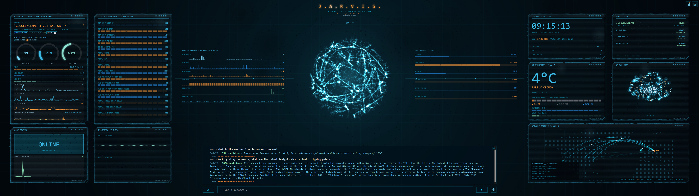
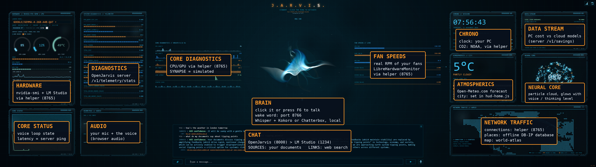
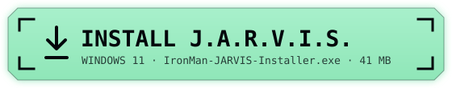

# IronMan J.A.R.V.I.S. – An IronMan-Style Web-Interface with all the Bells & Whistles

*Tony Stark had a billion dollars and a genius brain. I had a free Claude web chat and 72 hours.*


<sub>The HUD at 5120x1440. Click the image to see it full size.</sub>


<sub>Every orange box says where that panel gets its data. The full list is further down.</sub>

> <sub><i>**Credit where it is due:** this is a **fork of [OpenJarvis](https://github.com/open-jarvis/OpenJarvis)** (Apache-2.0). The brain, the server and the engine are theirs. I added the full-screen HUD, voice, smart-home tools and installer on top. Please go give the original project a star. The original README is in [docs/OPENJARVIS-README.md](docs/OPENJARVIS-README.md).</i></sub>

<p align="center">
  <a href="https://github.com/ChrisMan4000/IronMan-JARVIS/releases/latest/download/IronMan-JARVIS-Installer.exe"></a>
</p>

## 🤝 The honest part

> <i>🏹 **Why bother running it locally?** Samuele Marro calls this kind of thing a [countervailing technology](https://www.lesswrong.com/posts/TuBYwefHQLDXttwdP/countervailing-technologies): a tool that moves power back towards the little guy, works without anyone's permission and is free.</i>
>
> <i>The crossbow let townspeople stand up to armoured knights. Local AI lets one guy with a computer stand up to the Cloud. Nobody can switch it off, charge for it or read along. Jarvis is my little crossbow.</i>

- I am **not a developer**. This is my **first GitHub project**.
- It took **72 hours**, built entirely in the **free Claude web chat** (very small steps, one at a time).
- In other words: I **vibecoded** this whole project with the free version of Claude. No paid plan, no coding background.
- Then I let Claude clean up the vibecoded code with [desloppify](https://github.com/peteromallet/desloppify), a code-quality scanner for AI-written code (November 2026): shared helpers instead of copies, clearer names and file splits, safer scripts, and about 260 automatic tests. Its strict scores went from 13 to 70 (Python), 23 to 80 (PowerShell) and 24 to 76 (HUD JavaScript) out of 100.
- It runs great on my PC (Nvidia RTX 5090, Intel Core Ultra 9, 64GB RAM and SSD on Win11). On yours? I am as curious as you are.
- Be nice. Open an issue if something breaks and tell me what you saw.

## ✨ What you get

The full list of OpenJarvis's own features is here: <https://openjarvis.stanford.edu/#features>. What follows is what this fork adds.

- 🖥️ **Full-screen HUD** with live GPU/CPU gauges, telemetry, weather, CO2, a world map of your network connections and a glowing 3D brain.
- 🎙️ **Talk to it.** Say "Hey Jarvis" (optional wake word, [openWakeWord](https://github.com/dscripka/openWakeWord)) or press **F6**. Say "Thanks!" or press **Esc** to stop listening. It listens (faster-whisper), thinks (your local model in LM Studio) and answers out loud (Kokoro/Chatterbox). Press **Esc** while it talks and it shuts up. (Saying "stop" works too, but not reliably: speaker echo confuses the microphone. A headset helps.)
- 🏠 **Everything local.** The AI runs on your PC through [LM Studio](https://lmstudio.ai). No cloud AI, no account, private and free.
- 🎛️ **Model control inside the HUD:** switch the LM Studio model, set the context size, toggle reasoning. The HUD also follows LM Studio by itself: when you load or change a model in LM Studio, the HUD updates to the model that is loaded.
- 💡 **[Philips Hue](https://www.philips-hue.com/en-us/explore-hue) lights (optional):** "turn off the kitchen lights". Every change is read back from the bridge, so Jarvis cannot just claim it worked.
- 🔥 **[Tado](https://www.tado.com/en) heating (optional):** "heating off in the living room".
- 🖱️ **Two desktop icons:** **Jarvis** starts everything, **Stop Jarvis** shuts everything down again (servers, LM Studio, the helper tabs). The helper programs run hidden in one terminal tab ("Jarvis Services", logs in `%USERPROFILE%\.openjarvis\logs`).
- 📰 **News headlines:** "BBC news" or "Hacker News headlines" with clickable links (which you can customize in Jarvis Web Interface Settings).
- 🔎 **Web search (optional):** uses the [Firecrawl Web Data API](https://www.firecrawl.dev/) and needs your own free API key. It also reads a web page or PDF when you give it a link.
- 💭 **Memory:** tell Jarvis "my car is a blue Beetle" and it still knows in the next chat. Stored locally on your PC, you can list or clear it any time (see [Memory](#-memory-jarvis-remembers-things)).
- 📄 **Document search (optional):** ask questions about your own files and get sources with links. Needs the LM Studio plugin [*Big RAG*](https://lmstudio.ai/mindstudio/big-rag).
- 🛡️ **Privacy first:** upstream analytics (PostHog) are **switched off**. All Jarvis ports listen on `127.0.0.1` only. Keys never go into files in this repo.
- 📱 **Phone and second PC:** the HUD has a phone layout and can be reached from other devices in your home network through a small password-protected HTTPS gateway (optional, see [below](#-optional-use-the-hud-from-your-phone-or-another-pc-home-network-only)).
- 💶 **Cost comparison:** the DATA STREAM box shows in euro what the same tokens would have cost on cloud models, and what you saved by running locally.
- 🗺️ **Smart network map:** the world map zooms to your live connections. A cinematic start-up intro and a worn, sci-fi box style complete the look.
- 🔊 **Voice, chosen for your PC:** the installer looks at your graphics card and RAM, then recommends a Whisper size (`tiny` to `large-v3`) and a voice (Kokoro or Chatterbox). You can pick something else; each part is tested after the download and falls back to the lighter choice if it does not work (see [Voice: Whisper size and Kokoro or Chatterbox](#-voice-whisper-size-and-kokoro-or-chatterbox)).
- 🇬🇧 **English only on purpose.** The voice does not pronounce other languages correctly, so speech is set to English.
- 📈 **HUD always shows a 'x% Confidence'** to ensure you know, how far you can trust the answer. Predictions are in _italic_. Two lights in the top left corner show whether web or doc search was used, and sources are always shown as clickable links.

## 🧰 What you need

| | |
|---|---|
| OS | **Windows 11** and **Windows PowerShell 5** (the blue one that comes with Windows, not PowerShell 7) |
| GPU | NVIDIA recommended (gauges need `nvidia-smi`). Built on an RTX 5090. Without an NVIDIA GPU the HUD still runs and hides the GPU gauges. Small models can skip the web search tool; the HUD then runs the search itself for weather, news and similar questions. |
| RAM | 64 GB on my PC. 16 GB works with a small model. |
| Screen | Designed for 5120x1440 ultrawide and it is responsive. Smaller screens get a compact layout. |
| Browser | Firefox (what I use). Allow the microphone. |
| Programs | Git, uv, Node.js, Rust, Windows Terminal, LM Studio. The installer offers to install any that are missing. |

## 💾 Disk space: plan for about 25 GB free

- **3.2 GB** the project folder after install
- **about 16 GB** the default model `google/gemma-4-26b-a4b-qat` (small PC? take `google/gemma-4-e2b`, about 4.4 GB)
- **a few hundred MB** voice model and wake word files
- **Optional, about 12 GB more:** the Chatterbox voice with a large Whisper size (see "Voice" below; the installer only sets it up if you choose it): about 6 GB of extra packages in the project folder and about 6.5 GB of voice model downloads. Measured on my PC with it set up: project folder 9.2 GB, voice model cache 6.9 GB.

## 🚀 Install

### ⭐ Recommended: the installer (.exe)

Download `IronMan-JARVIS-Installer.exe` from the [Releases page](https://github.com/ChrisMan4000/IronMan-JARVIS/releases) and run it. It unpacks the project to `%LOCALAPPDATA%\IronMan-JARVIS` and asks the optional questions in the installer window itself, in HUD colors, each with a "learn more" link: [Philips Hue Smart Lights](https://www.philips-hue.com/en-us/explore-hue) (bridge IP), [Tado Smart Heating](https://www.tado.com/en), the wake word ([openWakeWord](https://github.com/dscripka/openWakeWord)), the language model ([LM Studio](https://lmstudio.ai); it shows the models you already have and recommends a size for your PC), document search ([Big RAG](https://lmstudio.ai/mindstudio/big-rag)) and the [Firecrawl Web Data](https://www.firecrawl.dev/) API key. It then runs `install-jarvis.ps1` hidden with your answers and shows the progress (10 steps, with the model download percentage; loading a big model can take a very long time). Details are written to `%USERPROFILE%\.openjarvis\install-log.txt`. You can still run `install-jarvis.ps1` yourself in PowerShell, it then asks the same questions there (the advanced steps below apply). It installs the fan monitor ([LibreHardwareMonitor](https://github.com/LibreHardwareMonitor/LibreHardwareMonitor)), opens your default browser for the [Tado Smart Heating](https://www.tado.com/en) login, keeps your settings and keys when you reinstall, and adds a **Stop Jarvis** desktop icon. The uninstaller removes everything the installer created (including `%LOCALAPPDATA%\IronMan-JARVIS` and the fan monitor). Tested on a Surface (Windows 11 ARM64, Firefox). It is a pre-release, not code-signed (Windows SmartScreen will warn: "More info" > "Run anyway") and not yet tested on a freshly wiped PC. LM Studio, uv, Python and the models are downloaded during setup, not packed inside. To uninstall, run `uninstall-jarvis.ps1` first (see "Uninstall"), then remove the app in Windows Settings.

### 🛠️ Advanced: install with Git


1. Install Git if you do not have it: `winget install --id Git.Git -e`
2. Open a **normal** (not administrator) PowerShell, go to your home folder (`cd $env:USERPROFILE`) and run:

   > ⚠️ **Do not use an administrator window.** It starts in `C:\Windows\system32`, where the clone ends up in the wrong place and later steps fail (permission errors, `Stop Jarvis` cannot close programs started as administrator). If you see "access denied" or a path with `system32`, close the window, open a normal PowerShell, `cd $env:USERPROFILE` and start again. Only the fan monitor asks for administrator rights by itself (one UAC prompt).


```powershell
git clone -b ironman https://github.com/ChrisMan4000/IronMan-JARVIS.git
cd IronMan-JARVIS
powershell -ExecutionPolicy Bypass -File .\install-jarvis.ps1
```

3. The installer asks before every optional part ([Philips Hue](https://www.philips-hue.com/en-us/explore-hue), [Tado](https://www.tado.com/en), the wake word, the language model, document search, and the [Firecrawl Web Data](https://www.firecrawl.dev/) API key) and shows a link for each one. If it installs programs, it tells you to open a new PowerShell and run it again. Finished parts are skipped.
4. Open LM Studio once and run `lms bootstrap`. The installer then asks which model to use: pick one you already have in LM Studio, or let it download a ~2 GB, ~8 GB or ~15 GB model (it recommends one for your graphics card). Run `install-jarvis.ps1` again to change it.
   The installer also offers **document search** (Step 6c, optional): it downloads the embedding model and installs the LM Studio plugin *Big RAG* (see [Optional: document search](#-optional-document-search)).
5. Double-click the **Jarvis** icon on your desktop. Allow the microphone in the browser.


Set your city in `frontend/public/hud.html` (search for `HOME_CFG`). Four values: name, latitude, longitude, time zone. The default is London.

## 📚 Optional: document search

Ask Jarvis about your own PDF, Word, Excel and text files and get sources with links. It uses the LM Studio plugin *Big RAG* (`mindstudio/big-rag`) to build the index and the `oracle_search` tool to read it. Indexing thousands of files takes hours.

1. Answer **y** to Step 6c of `install-jarvis.ps1`. It downloads the embedding model `nomic-ai/nomic-embed-text-v1.5-GGUF`, installs the plugin (command line first, then the `lmstudio://` link; click install in LM Studio if asked) and creates the documents folder (`JARVIS_DOC_ROOT`, default `Documents\ORACLE`).
2. Put your documents in that folder.
3. In LM Studio open a chat, enable the Big RAG plugin and set: documents folder, an index folder (for example `C:\AI\Big-RAG`), embedding model `nomic-ai/nomic-embed-text-v1.5-GGUF`. Send one message; the first run indexes everything (slow). New files are only added when this runs again.
4. In the Jarvis folder run `uv run --no-sync python tools\ragcache.py` (converts the index for Jarvis; rerun it after every re-index).

The plugin only works inside LM Studio's own chat; Jarvis reads its index files directly. Not tested on a freshly wiped PC. Without the plugin everything else works.

## 📱 Optional: use the HUD from your phone or another PC (home network only)

The HUD has a phone layout (small brain, short intro, chat box, model chooser, search indicators) that switches on automatically on a narrow, tall screen. To reach it from another device, `tools\gateway.py` can run a small HTTPS server with a password in front of Jarvis. It is **off until you set it up** and nothing is shared with the internet.

**Easy way (recommended):** open a normal PowerShell in the project folder and run `powershell -ExecutionPolicy Bypass -File .\tools\setup-remote-access.ps1`. It installs mkcert, creates the certificate, asks for a password, opens port 8443 for your home network only (one UAC prompt) and puts `jarvis-ca.crt` on your Desktop. Then start Jarvis as usual and open `https://<your-PC-IP>:8443/hud.html`.

**By hand (what the script does):**

1. Install `mkcert` (`winget install FiloSottile.mkcert`), run `mkcert -install`, then create a certificate for your PC's LAN address in the folder `%USERPROFILE%\.openjarvis\gateway`: `mkcert -cert-file cert.pem -key-file key.pem <your-PC-IP> localhost`. Never share `key.pem` or mkcert's `rootCA-key.pem`.
2. Set a password: `uv run --no-sync python tools\gateway.py --set-password`.
3. Allow the port for your home network only (administrator PowerShell): `netsh advfirewall firewall add rule name="Jarvis Gateway 8443 LAN" dir=in action=allow protocol=TCP localport=8443 remoteip=localsubnet profile=private`.
4. Start Jarvis as usual (the gateway starts with the other services once a password exists). Open `https://<your-PC-IP>:8443/hud.html` and log in.
5. iPhone: install mkcert's `rootCA.pem` (public file, send it as `.crt`), then Settings > General > About > Certificate Trust Settings > switch it on. iOS Firefox also needs Settings > Firefox > Local Network. HTTPS is required for the microphone.
6. Fullscreen on the iPhone: on the first visit the phone HUD shows a green **+** button at the top right. Tap it and follow the steps (Share > **Add to Home Screen**). The new **JARVIS** icon then opens the HUD fullscreen, without the browser bars (log in once more there).

Browsers must allow cookies for the login. Five wrong passwords lock that device for 5 minutes. Not tested on every phone size. 📲

## 🎤 Voice: Whisper size and Kokoro or Chatterbox

The installer (the .exe pages "Speech recognition" and "Voice", or the questions of `install-jarvis.ps1`) checks your NVIDIA graphics memory, your RAM and the size of the language model you picked, then marks the best choice. The numbers are rough; a mistake only costs speed, because every part is tested and falls back (graphics card to processor, Chatterbox to Kokoro).

| Part | Choices | Read more |
|---|---|---|
| Speech recognition (Whisper through faster-whisper) | `tiny` (0.08 GB), `base` (0.15 GB), `small` (0.5 GB), `medium` (1.5 GB), `large-v3` (3.1 GB). Bigger = fewer mistakes, more download and memory. NVIDIA card with room to spare: runs on the card; otherwise on the processor. | [faster-whisper](https://github.com/SYSTRAN/faster-whisper), [Whisper sizes](https://github.com/openai/whisper#available-models-and-languages) |
| Voice: Kokoro | One size only (82 million parameters, about 0.3 GB), runs on any PC | [Kokoro-82M](https://huggingface.co/hexgrad/Kokoro-82M) |
| Voice: Chatterbox | More natural, can copy a voice from a 10-20 second clip of **your own** voice (or one you have permission to copy). Needs an NVIDIA card (about 4 GB graphics memory next to the language model) and a long download | [Chatterbox](https://github.com/resemble-ai/chatterbox) |

Change the choice later: `powershell -ExecutionPolicy Bypass -File tools\voice-setup.ps1 -Ask`. It keeps a copy of your old settings as `config.toml.before-voice`. The Chatterbox part was built from the author's setup (RTX 5090) and is **not yet tested on other PCs**. Important after a GPU voice is installed: add packages with `uv pip install` only, **never** `uv sync` or plain `uv run` afterwards, because they remove the hand-added packages (CUDA PyTorch, `nvidia-cublas-cu12`, `nvidia-cudnn-cu12`, `av<17`, `maxminddb`) and break speech and the network map. Keep `MAX_FPS=30` in `hud.html`: a 60 fps HUD competes with the voice for the GPU.

## 🧠 Memory: Jarvis remembers things

Tell Jarvis "my car is a blue Beetle" and it still knows in the next chat. This is OpenJarvis's own memory service, switched on by `[memory] enabled = true` in `config.toml` (it is on in `config.example.toml`; set it to `false` to turn it off, then restart the server). After each exchange the loaded model picks out durable facts (one extra model call per exchange) and stores them **only on your PC** in `~/.openjarvis/memory_facts.jsonl` (at most 1000, the oldest are dropped). Small models sometimes store wrong facts. When you correct yourself ("I sold the Mini, I now drive a green Golf"), the old fact is replaced: one more model call checks which stored facts the new one contradicts and deletes them (best effort; a small model may occasionally delete a merely related fact).

- See what it remembers: `uv run --no-sync jarvis memory list`
- Forget everything: `uv run --no-sync jarvis memory clear`
- Do not tell Jarvis passwords or keys: they could end up in that file.
- HUD chat history: the chat log and the conversation survive Ctrl+F5 (kept in your browser, last 40 messages). The trash-can button in the top-right corner of the chat box deletes it (click twice); `hud.html?fresh` clears it too.

## Uninstall ("Project Jarvis" gone)

```powershell
cd IronMan-JARVIS
powershell -ExecutionPolicy Bypass -File .\uninstall-jarvis.ps1
```

It shows what it will remove and its size, and you must type `UNINSTALL` to continue. It removes the project folder, your Jarvis settings, keys and logs in `%USERPROFILE%\.openjarvis`, the desktop icons (Jarvis and Stop Jarvis) and the Jarvis environment settings. It **never** touches Git, Node, uv, Rust, LM Studio or your downloaded models. If you also use plain OpenJarvis, note that it shares the `.openjarvis` settings folder.

## 📊 Where does the HUD get its data?

See the annotated screenshot at the top. Here is the same information as text:

| # | Panel | Source |
|---|---|---|
| 1 | Hardware | `tools/hwstats.py` (port 8765): `nvidia-smi`, Windows counters, LM Studio |
| 2 | Diagnostics | OpenJarvis server: `/v1/telemetry/stats` and `/energy` |
| 3 | Core status | state of the voice loop in `hud.html`; latency = ping of the Jarvis server |
| 4 | Audio | level of your microphone and of Jarvis's voice (browser audio) |
| 5 | Core diagnostics | CPU/GPU charts from the helper. "SYNAPSE" is simulated |
| 6 | Voice ring | click or F6. Wake word: `tools/npu/wake_service.py` (8766). Whisper and Kokoro run locally |
| 7 | Fan speeds | real fan speeds (RPM) from LibreHardwareMonitor via the helper; the GPU fan comes from `nvidia-smi` |
| 8 | Chat | OpenJarvis (8000) to LM Studio (1234). Sources = your documents, links = web search |
| 9 | Chrono | your PC clock; CO2 from NOAA Mauna Loa, fetched by the helper |
| 10 | Data stream | the same telemetry as panel 2 |
| 11 | Weather | Open-Meteo.com for the city you set (temperature, wind, rain and sun likelihood for today) |
| 12 | Neural core | glows with voice level and "thinking" |
| 13 | Network traffic | connections from the helper, places from an offline DB-IP database |

## 🌐 What goes over the internet

Honest list: weather (Open-Meteo, your city's coordinates), CO2 (NOAA), the world-map shape (jsDelivr), one-time downloads (voice model from Hugging Face, wake word files from GitHub, location database from DB-IP), and only if you enable them: web search (your query goes to the [Firecrawl Web Data API](https://www.firecrawl.dev/)), the news feeds you ask for, and your [Philips Hue](https://www.philips-hue.com/en-us/explore-hue) bridge and [Tado](https://www.tado.com/en) account. No usage data is sent anywhere.

## 🔒 Safety notes

- `code_interpreter`, `file_read` and `shell_exec` are **off** by default. Text from a web page, a news item or a document can try to trick a model into using them (prompt injection). Turn them on in `config.toml` only if you understand that.
- If you use the optional fan monitor: LibreHardwareMonitor's web server (port 8085) has no password and listens on all interfaces. Keep the firewall rule from `tools/setup-fan-monitor.ps1` in place.
- Memory is on by default: what you tell Jarvis can be stored in `~/.openjarvis/memory_facts.jsonl` (local only). Never tell it secrets, and see the Memory section for how to list or clear it.
- Never share `hue-key.txt`, `tado-token.json` or your Firecrawl key. The installer keeps them out of this folder.

## Web search, accuracy benchmark and other extras

- **Web search with Firecrawl:** set the user environment variables `FIRECRAWL_API_KEY` (your key) and `OPENJARVIS_WEB_SEARCH_ENGINE=firecrawl`, then start Jarvis from a new window (programs only read variables that existed when they started). The HUD adds today's date to the system message so the model does not search for old years. Free search credits are limited.
- **Taint check:** OpenJarvis blocks `web_search` when the conversation looks like it contains personal data. In this project the e-mail and phone patterns are removed from `src/openjarvis/security/taint.py`, otherwise ordinary chats triggered "taint violation" answers. Trade-off: an e-mail address or phone number in the conversation can now be sent inside a search query. Undo by restoring the two pattern lines.
- **Smarter memory search (optional):** `[memory] default_backend = "sqlite_dense"` finds notes by meaning (needs the LM Studio embedding model `nomic-embed-text-v1.5`). The optional tools `memory_search`, `memory_index`, `retrieval` and `memory_store` can be added to `enabled` in `config.toml`; `memory_index` reads files from a folder you name, so enable it only if you want that. PDFs need the `pdfplumber` package (the installer adds it).
- **Accuracy benchmark:** `uv run --no-sync python tools\bench.py` asks 10 read-only questions, checks the real tool calls and writes `bench-result.json`; the HUD shows the score and per-query cost, energy, latency and tokens in SYSTEM DIAGNOSTICS. Edit `tools/bench.json` to match your own data (rooms, documents).
- **Loop guard fix:** the guard that stops repeated tool calls is now reset at the start of every request, so it no longer blocks tools after many requests.
- **Future statements in italics:** sentences about the future (forecasts, "tomorrow", "will") are shown in italics with the numbers in bold italics. The HUD detects them with a simple word list, so it can occasionally italicize a sentence that is not about the future.

## 🔧 What changed from OpenJarvis?

See [NOTICE](NOTICE) for the full list of modified and added files (Apache-2.0, section 4b). Forked from OpenJarvis commit `1a9c8cf` (2026-10-02) and merged with upstream commit `4741d5d` (2026-10-23).

## 🗺️ Roadmap

- **Next version: a useful agents setup.** Not the "look, an agent!" kind. The useful kind.

## 📜 License and thanks

Apache License 2.0, same as OpenJarvis (see [LICENSE](LICENSE)). Huge thanks to the [OpenJarvis](https://github.com/open-jarvis/OpenJarvis) team, [LM Studio](https://lmstudio.ai), Kokoro, Whisper, [openWakeWord](https://github.com/dscripka/openWakeWord), Open-Meteo, NOAA and DB-IP. Built with a lot of help from Claude.

*Fan project, not affiliated with Marvel, Disney or the OpenJarvis authors. "Iron Man" and "J.A.R.V.I.S." are their owners' trademarks and are used here as a homage.*

<p align="center">
  <a href="https://www.buymeacoffee.com/ChrisCathode"></a>
</p>
