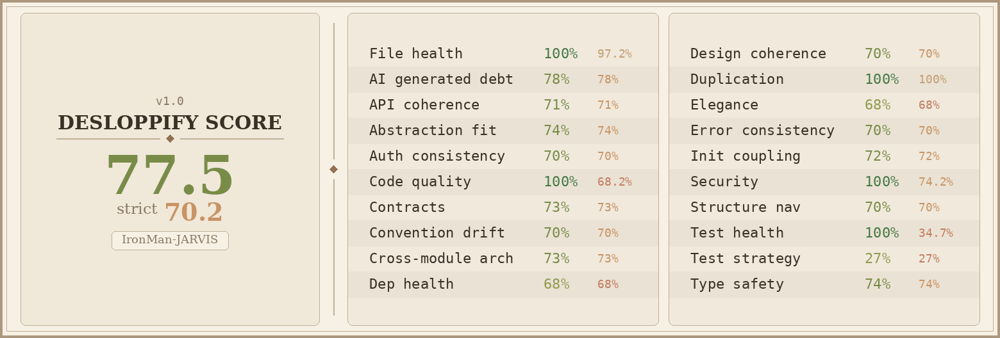

# IronMan J.A.R.V.I.S. – An IronMan-Style Web-Interface with all the Bells & Whistles

*Tony Stark had a billion dollars and a genius brain. I had a Claude chat and about 120 hours.*


<sub>The HUD at 5120x1440. Click the image to see it full size.</sub>


<sub>Every orange box says where that panel gets its data.</sub>

> <sub><i>**Credit where it is due:** this is a **fork of [OpenJarvis](https://github.com/open-jarvis/OpenJarvis)** (Apache-2.0). The brain, the server and the engine are theirs. I added the full-screen HUD, voice, smart-home tools and installer on top. Please go give the original project a star. The original README is in [docs/OPENJARVIS-README.md](docs/OPENJARVIS-README.md).</i></sub>

<p align="center">
  <a href="https://github.com/ChrisMan4000/IronMan-JARVIS/releases/latest/download/IronMan-JARVIS-Installer.exe"></a>
</p>

## 🤝 The honest part

> <i>🏹 Local AI is a [countervailing technology](https://www.lesswrong.com/posts/TuBYwefHQLDXttwdP/countervailing-technologies) (Samuele Marro): it moves power back towards the little guy. Nobody can switch it off, charge for it or read along. Jarvis is my little crossbow.</i>

- I am **not a developer**. This is my **first GitHub project**, **vibe coded** in about **24 days**, first in the free Claude chat, later in a paid plan.
- Then Claude cleaned up the code with [desloppify](https://github.com/peteromallet/desloppify), a code-quality scanner for AI-written code: shared helpers instead of copies, clearer names, safer scripts and about 260 automatic tests (strict scores from 13-24 to 70-80 out of 100).

  <p align="center">
    <a href="https://github.com/peteromallet/desloppify"></a>
  </p>
- It runs great on my PC (Nvidia RTX 5090, Intel Core Ultra 9, 64GB RAM and SSD on Win11). It adapts the models and tools to your specific hardware, so a decent laptop should run it as well with a lighter model.
- Be nice. Open an issue if something breaks and tell me what you saw.

## ✨ What you get

On top of [OpenJarvis's own features](https://openjarvis.stanford.edu/#features):

- 🖥️ **Full-screen HUD:** live GPU/CPU gauges, telemetry, weather, CO2, a world map of your network connections, a living, voice-reactive vortex brain, a cinematic intro. Phone layout included.
- 🎙️ **Talk to it:** say "Hey Jarvis" or press **F6**; **Esc** stops it. Local speech recognition (faster-whisper) and voice (Kokoro or Chatterbox), chosen for your PC by the installer.
- 🏠 **Everything local:** the AI runs on your PC through [LM Studio](https://lmstudio.ai). No cloud AI, no account. Switch model, context size and reasoning/thinking inside the HUD.
- 💡 **Smart home (optional):** [Philips Hue](https://www.philips-hue.com/en-us/explore-hue) smart lights, [Tado](https://www.tado.com/en) smart heating and a [Sonos](https://www.sonos.com) speaker or soundbar (play, pause, etc.). Every change is read back, so Jarvis cannot just claim it worked.
- 🔎 **Web search, news and documents (optional):** web search with the [Firecrawl](https://www.firecrawl.dev/) API (your own free key), news headlines, and questions about your own files with the LM Studio plugin [Big RAG](https://lmstudio.ai/mindstudio/big-rag). Sources are always clickable links.
- 💭 **Memory:** tell it "my car is a blue Beetle" and it still knows in the next chat (stored only on your PC).
- 📈 **Honest answers:** every answer shows its confidence %, predictions are in _italic_, two lights show whether web or document search was used.
- 💶 **Cost comparison:** what the same tokens would have cost on cloud models.
- 🛡️ **Privacy first:** upstream analytics are switched off, all Jarvis ports listen on `127.0.0.1` only.
- 🖱️ **Two desktop icons:** **Jarvis** starts everything, **Stop Jarvis** shuts it all down.

## 🧰 What you need

| | |
|---|---|
| OS | **Windows 11** with Windows PowerShell 5 (the built-in blue one) |
| GPU | NVIDIA recommended. Without one the HUD still runs (no GPU gauges) with a smaller model. |
| RAM | 16 GB works with a small model; 64 GB on my PC. |
| Disk | about **25 GB** free (project ~3 GB, default model ~16 GB; a small model is ~4 GB). The bigger Chatterbox voice needs about 12 GB more. |
| Browser | Firefox (what I use). Allow the microphone. |

## 🚀 Install

**Recommended:** download [IronMan-JARVIS-Installer.exe](https://github.com/ChrisMan4000/IronMan-JARVIS/releases/latest/download/IronMan-JARVIS-Installer.exe) and double-click it as a normal user (not as administrator). It asks the optional questions in its own window (Hue, Tado, wake word, model, voice, document search, Firecrawl key, your city), downloads what is missing (Git, uv, Node.js, Rust, LM Studio, the models) and shows the progress. For Tado your browser opens once: **sign in to your Tado account first**, then approve. The installer is not code-signed: Windows SmartScreen warns, click "More info" > "Run anyway". Log: `%USERPROFILE%\.openjarvis\install-log.txt`.

**Advanced, with Git** (normal PowerShell, not administrator):

```powershell
cd $env:USERPROFILE
git clone -b ironman https://github.com/ChrisMan4000/IronMan-JARVIS.git
cd IronMan-JARVIS
powershell -ExecutionPolicy Bypass -File .\install-jarvis.ps1
```

It asks the same questions in the console; run it again to change a choice. Then double-click the **Jarvis** icon. It asks for your city for the HUD weather; change it later with `powershell -ExecutionPolicy Bypass -File tools\set-home-city.ps1`.

## ⚙️ Optional parts

- **Document search:** answer **y** to the document step, put your files in the documents folder (`JARVIS_DOC_ROOT`, default `Documents\ORACLE`), let the Big RAG plugin index them once in an LM Studio chat, then run `uv run --no-sync python tools\ragcache.py` (again after every re-index). Indexing thousands of files takes hours.
- **Phone or second PC (home network only):** run `powershell -ExecutionPolicy Bypass -File .\tools\setup-remote-access.ps1`. It creates a certificate, asks for a password and opens port 8443 for your home network. Then open `https://<your-PC-IP>:8443/hud.html`. On an iPhone, "Add to Home Screen" gives a fullscreen JARVIS icon.
- **Change the voice later:** `powershell -ExecutionPolicy Bypass -File tools\voice-setup.ps1 -Ask`. After a GPU voice is installed add packages with `uv pip install` only, **never** `uv sync` (it removes the hand-added GPU packages).
- **Memory:** `uv run --no-sync jarvis memory list` shows what it remembers, `uv run --no-sync jarvis memory clear` forgets everything. Turn it off with `[memory] enabled = false` in `config.toml`.
- **Accuracy benchmark:** `uv run --no-sync python tools\bench.py` (10 read-only questions; the HUD shows the score).

## 🌐 Privacy and safety

- **Over the internet:** weather (Open-Meteo), CO2 (NOAA), one-time downloads (models, wake word, location database), and only if you enable them: web search queries (Firecrawl), news feeds, your Hue bridge and Tado account. No usage data is sent anywhere.
- `code_interpreter`, `file_read` and `shell_exec` are **off** by default: text from a web page or document could trick a model into using them.
- Never share `hue-key.txt`, `tado-token.json` or your Firecrawl key, and do not tell Jarvis passwords (they could end up in its memory file).
- In this project the e-mail and phone patterns of OpenJarvis's taint check are removed (they blocked ordinary web searches), so such details in a chat can end up in a search query.

## 🧹 Uninstall

Installed with the .exe: remove **IronMan J.A.R.V.I.S.** in Windows Settings > Apps. Installed with Git: run `powershell -ExecutionPolicy Bypass -File .\uninstall-jarvis.ps1` in the project folder (type `UNINSTALL` to confirm). Both remove the project, its settings in `%USERPROFILE%\.openjarvis` and the desktop icons; they never touch Git, Node, uv, Rust, LM Studio or your downloaded models.

## 📜 License and thanks

Apache License 2.0, same as OpenJarvis (see [LICENSE](LICENSE); changed and added files in [NOTICE](NOTICE)). Forked from OpenJarvis `1a9c8cf`, merged with upstream `4741d5d`. Huge thanks to the [OpenJarvis](https://github.com/open-jarvis/OpenJarvis) team, [LM Studio](https://lmstudio.ai), [Kokoro](https://github.com/hexgrad/kokoro), [Chatterbox](https://github.com/resemble-ai/chatterbox), [Whisper](https://github.com/openai/whisper) (via [faster-whisper](https://github.com/SYSTRAN/faster-whisper)), [openWakeWord](https://github.com/dscripka/openWakeWord), [Open-Meteo](https://open-meteo.com), [NOAA Global Monitoring Laboratory](https://gml.noaa.gov/ccgg/trends/) (CO2 data), [DB-IP](https://db-ip.com) (IP geolocation), [LibreHardwareMonitor](https://github.com/LibreHardwareMonitor/LibreHardwareMonitor), [Firecrawl](https://www.firecrawl.dev) and [world-atlas](https://github.com/topojson/world-atlas) (map data from [Natural Earth](https://www.naturalearthdata.com)). Built with a lot of help from [Claude](https://claude.ai). Next version: a useful agents setup.

*Fan project, not affiliated with Marvel, Disney or the OpenJarvis authors. "Iron Man" and "J.A.R.V.I.S." are their owners' trademarks and are used here as a homage.*

<p align="center">
  <a href="https://www.buymeacoffee.com/ChrisCathode"></a>
</p>
